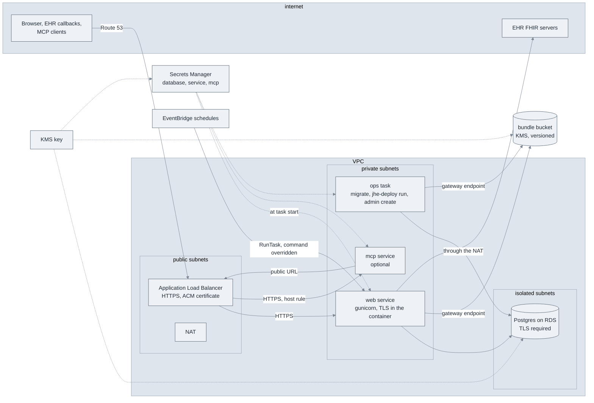

# JupyterHealth Exchange on AWS

A representative deployment of [JupyterHealth Exchange](https://github.com/the-commons-project/jupyterhealth-exchange)
(JHE) on AWS, as CDK code in Python plus one deploy script. It is a working starting point,
written to be read and adapted for your organization, its standards, and its policies.

**Status: sandbox-grade.** The defaults are sized for a sandbox; section 5 says what each one
assumes.

## 1. Architecture



Requests reach the ALB in the public subnets and nothing else does: every task runs in the
private subnets with egress through the NAT (the EHRs are on the internet), and Postgres sits
in the isolated subnets with no route out. The ALB terminates the public HTTPS and re-encrypts
to the containers, which serve TLS themselves (section 9).

Two task definitions run the JHE image, and the boundary between them is who starts them:

| Task definition | Started by | Privileges |
|---|---|---|
| **web** | ECS, as the service behind the ALB; EventBridge, for the two scheduled commands, with the command overridden | the application's: its database credentials, the bundle bucket |
| **ops** | a person: `jhe-deploy deploy` (migrate), `jhe-deploy run`, `admin create` | the operator's: the bucket, and the migrate database credentials when that follow-on lands |

The scheduled jobs are the application's own background work, so they run as the web service
and get exactly its privileges. Anything a person runs uses the ops task, which holds the union
of what a one-off command might need, so there is no flag to pick and nothing automated ever
carries migration credentials. The MCP server is a third task definition with its own image
and no credentials beyond its OAuth client; it reaches JHE through the public URL.

### How the stacks map to it

```
network ──> shared (ECR, cluster)
   │           │
   └──> data ──┴──> ops ──> compute ──> monitoring

access (the deployer policy; depends on nothing)
```

| Stack | Holds | Configuration section | Replaceable |
|---|---|---|---|
| `network` | VPC, subnets, NAT, S3 gateway endpoint, flow logs | `network` | no: termination protection |
| `shared` | ECR repositories, ECS cluster | (none) | no |
| `data` | KMS key, Postgres, the bundle and ALB-log buckets, the secrets, the database security group | `data` | no: everything retained on deletion |
| `ops` | the ops task definition, its role, security group and log group | `ops` | yes |
| `compute` | certificate, ALB, web and mcp services, the schedules, DNS records | `compute` | yes |
| `monitoring` | alarms, the SNS topic, the failed-task notification | `monitoring` | yes |
| `access` | the `JheDeployer` managed policy and who holds it | `access` | yes, by `jhe-deploy access` only |

The first three hold everything stateful or slow to replace and carry termination protection.
The last three can be destroyed and redeployed freely: `jhe-deploy down` destroys `compute`
and `monitoring` (`ops` holds nothing running and stays), `up` brings them back, and each
release deploys `ops` with the new image and runs the migration before `compute` rolls, so a
bad image or a failing migration stops before anything user-facing changes.
`access` is outside both groups: it says who may deploy, an administrator's decision made
once, so it has its own command and `deploy` never touches it (section 7).

## 2. The whole sequence

From an empty account to a patient's records in the bucket, in order. Each step names the
section that explains it.

Every `jhe-deploy` below is `uv run jhe-deploy -c config/local/<name>.json …` from this
repository, written short.

1. **Tooling** ([section 7](#7-prerequisites-and-permissions)): Node 22 or later,
   `npm install -g aws-cdk`, `uv sync`, Docker with buildx (on an x86 Linux host, arm64 builds
   need QEMU: `docker run --privileged --rm tonistiigi/binfmt --install arm64`), the AWS CLI
   logged in to the account as an administrator. The Docker daemon has to be running when the
   image step starts, about ten minutes into the first deploy.
2. **DNS** ([section 7](#7-prerequisites-and-permissions)): a Route 53 hosted zone the
   environment's names are in or under, delegated from its parent on the public internet
   (`dig NS <zone>` answers with the zone's four name servers). Note its zone id.
3. **Configuration** ([section 6](#6-configuration)): copy `config/example.json` to
   `config/local/<name>.json`, replace every placeholder, keep every other key (the file is
   the defaults; [section 5](#5-what-the-defaults-assume) lists what a sandbox changes).
4. **Bootstrap** ([section 7](#7-prerequisites-and-permissions)), once, as an administrator:
   `jhe-deploy bootstrap`.
5. **Access** ([section 7](#7-prerequisites-and-permissions)), optional: `jhe-deploy access`,
   then a permission set or an attached principal for whoever deploys from here on.
6. **First deploy** ([section 8](#8-first-deploy)): `jhe-deploy deploy --jhe-path <JHE
   checkout>`. It stops at the secrets check, which is expected; `jhe-deploy secrets init`,
   then `deploy` again (the images are cached, or pass the digests the first run printed with
   `--web-image` and `--mcp-image`). About twenty-five minutes in all; the result is the web
   URL, and the database has its reference data and the web UI's OAuth client from
   `bootstrap`, which `deploy` runs after `migrate`.
7. **The first admin** ([section 8](#8-first-deploy)): `jhe-deploy admin create --email
   <you>` (not `admin@example.com`, which the demo seed creates), the password from the
   `jhe/<env>/bootstrap-admin` secret. Log in at the web URL and change it, then
   `jhe-deploy admin forget`.
8. **Registration** ([section 8](#8-first-deploy)): closed until you set
   `site.registration_invite_code` under Settings. Leave it closed if admins create users.
9. **Demo data**, optional ([section 8](#8-first-deploy)): `jhe-deploy run -- python
   manage.py seed --with-rich-demo` is the development fixture, with its known passwords and
   invite code to change afterwards; `seed_patient_access_sandbox` adds the SMART Health IT
   sandbox "hospitals" so a pull can be tried without an EHR account.
10. **Where pulls are delivered** ([section 8](#8-first-deploy)): the four
    `patient_access.s3.*` settings, created under Settings as new system settings, then
    `jhe-deploy run -- python manage.py patient_access_check`.
11. **Verify a pull**: as a manager (`manager_mary@example.com` after the seed), open a
    patient (the seed's patient 40001, say), *Generate Invitation Link* with the *USCDI
    Patient Access* client, open the link, agree to share, pick *SMART Sandbox Express (no
    login, fixed patient)* and continue. "Importing your records" runs to completion, the
    bundle appears in the bucket (`aws s3 ls s3://<bucket> --recursive`), and `jhe-deploy
    logs web --filter job` shows the job's lines. JHE's
    `patient_access/scripts/validate_patient_access_bundle.py` checks the file.
12. **Afterwards**: register the MCP client, `secrets set --secret mcp …`, and `deploy` again
    to bring the MCP service up ([section 8](#8-first-deploy)); `down` when the environment
    is idle ([section 10](#10-operating-it)).

## 3. What JHE requires at runtime

For designing a deployment other than this one. Everything here is a property of JHE itself,
read from its source (`jhe/settings.py`, `Dockerfile`, `deploy/entrypoint.sh`, the
`patient_access` package, `mcp_server/`), not of this repository; where this repository made a
choice rather than met a requirement, the text says so. Section 1 is one architecture that
satisfies this list.

### Processes

| Process | What it is | Started by | Needs |
|---|---|---|---|
| **web** | gunicorn serving Django on port 8000. The image runs two synchronous workers with a 30-second timeout; tune by overriding the command | always on, behind a load balancer that terminates the public HTTPS and sends `X-Forwarded-Proto` | the database, the secrets, writable local disk, outbound internet |
| **a patient-access pull** | a thread *inside the web process* that handled the patient's consent (JHE's dispatcher is `thread`): fetch from the EHR into a local spool, deliver to object storage | a consent | the web process to live through the pull; see *Disk and state* |
| **`patient_access_run_jobs`** | the sweep: resumes pulls whose process died, retries failed deliveries, removes orphaned spools. JHE's own crontab runs it every minute; this repository every five, a cost choice (each run here is a task launch) | cron | the same as web |
| **`ow_poll`** | Open Wearables polling; exits at once while the module is off in Settings | cron, every 15 minutes | the same as web |
| **migrate**, then **bootstrap** | `manage.py migrate` before each release, then `manage.py bootstrap`, idempotent: the reference data and the web UI's OAuth client a fresh database lacks | an operator, before the new version serves | the database credential; today the same one the web process uses |
| **one-off commands** | any `manage.py` command: seeds, checks, data fixes | an operator | as migrate |
| **mcp** | the MCP server, a separate image on port 8401, under its own hostname | always on | its own secret; it reaches JHE through JHE's public URL, never directly |

### Environment and secrets

Every variable `jhe/settings.py` reads. *Secret* means it must come from a secret store; the
rest are plain configuration.

| Variable | Required | Secret | What it is |
|---|---|---|---|
| `SECRET_KEY` | yes | yes | Django's signing key; rotating it invalidates sessions |
| `DB_HOST`, `DB_PORT`, `DB_NAME`, `DB_USER`, `DB_PASSWORD` | yes | the password | Postgres |
| `DB_SSLMODE`, `DB_SSLROOTCERT` | | | libpq's TLS mode and CA bundle. Unset, the driver *prefers* TLS and never verifies the server; `verify-full` with the server's CA bundle makes the hop authenticated. This repository sets both and builds the bundle into the image |
| `SITE_URL` | yes | | the public URL; `ALLOWED_HOSTS` and `CSRF_TRUSTED_ORIGINS` derive from it unless set |
| `OIDC_RSA_PRIVATE_KEY` | yes | yes | the key JHE signs its own OIDC tokens with |
| `PATIENT_ACCESS_ENCRYPTION_KEYS` (or `_FILE`) | for patient access | yes | comma-separated Fernet keys, the first encrypts; EHR tokens and spool keys at rest |
| `PATIENT_ACCESS_SPOOL_DIR` | | | where a pull waits between fetch and delivery; default `/data/patient-access/spool` |
| `ALLOWED_HOSTS` | | | comma-separated; set here to both hostnames |
| `SECURE_HSTS_SECONDS`, `SECURE_HSTS_INCLUDE_SUBDOMAINS` | | | HSTS on HTTPS responses; off unless set |
| `SMTP_HOST`, `SMTP_PORT`, `SMTP_USER`, `SMTP_PASSWORD` | | user, password | the mail relay; see *Email* |
| `OW_S3_ENDPOINT_URL`, `OW_S3_BUCKET`, `OW_S3_PREFIX`, `OW_S3_REGION`, `OW_S3_ACCESS_KEY`, `OW_S3_SECRET_KEY` | for Open Wearables | the keys | raw-payload storage for the Open Wearables module |
| `DJANGO_LOG_LEVEL`, `TIME_ZONE`, `X_FRAME_OPTIONS`, `JHE_IGNORE_DOTENV`, `PATIENT_ACCESS_HTTP_DEBUG_LOGGING` | | | plain knobs; `JHE_IGNORE_DOTENV=1` stops the image reading a `.env` file |
| `DEBUG` | | | **never set in a deployment**: debug mode, and with it plain-HTTP EHR endpoints. (Read as a flag: `false` is false) |
| `JHE_TLS`, `JHE_TLS_CN`, `JHE_TLS_DAYS`, `JHE_TLS_DIR`, `JHE_TLS_CERTFILE`, `JHE_TLS_KEYFILE` | | | the image's entrypoint: `self-signed` or `provided` makes gunicorn serve HTTPS (section 9) |

The MCP server reads `JHE_BASE_URL`, `JHE_REDIRECT_URI`, `JHE_CLIENT_ID` and `JHE_CLIENT_SECRET`
(secret; the OAuth client registered in JHE), `MCP_BROKER_KEY` (secret), `MCP_RESOURCE_URL`,
`MCP_REQUIRE_AUDIENCE` (this repository sets it true, which is not the server's default),
`MCP_HTTP_PORT`, and `MCP_TLS` and `MCP_TLS_CN` for its own certificate. Its `/register`
endpoint is open dynamic client registration, and `mcp_server/README.md` asks for rate
limiting at an edge; this repository provides none.

### Settings rows

Some of what JHE needs is database rows under Settings in the web UI (or the Django admin's
JHE settings), not configuration. `bootstrap` creates the rows with neutral values; two of
them the operator must then set:

- `site.registration_invite_code`: the code a visitor must give to self-register. Created
  empty, which keeps registration closed; set it to open registration.
- `patient_access.s3.*`: where pulls are delivered (section 8). Until set, every pull waits.
- The EHR vendor rows: the client id of your own EHR app registration, entered on the EHRs
  page; brands and locations imported from the EHR's published bundle with
  `import_ehr_brands`.

### Database

Postgres, 16 here. One role for everything: JHE has no notion of a separate migration
credential, so whoever runs `migrate` holds the same credential the web process serves with.
Require TLS on the server (`rds.force_ssl` here) and verify it from the client (above).
Sessions, tokens and all application state live in the database; the web process keeps
nothing locally that another copy would need.

### Object storage

Each pull becomes one FHIR document bundle written to S3, or any S3-compatible store, under a
layout the module computes. Where, and with what credentials, comes from the
`patient_access.s3.*` Settings rows, not the environment: bucket, region, optional endpoint,
encryption mode, and either an access key pair or nothing, in which case the process's own
IAM identity is used, which is what this repository does. The bucket must allow put, get and
a delete of the module's probe marker. Versioning the bucket is this repository's choice; a
versioned bucket keeps prior versions of a bundle, so this repository expires them after
`data.bundle_noncurrent_version_days`, and a data-deletion request must purge versions, not
only the current object.

### Disk and state

A pull spools fetched documents to local disk under `PATIENT_ACCESS_SPOOL_DIR` before
delivery, up to the module's caps, `patient_access.documents.max_total_bytes` (20 GiB by
default) per pull. The web task therefore needs writable local disk sized for the concurrent
pulls you expect, or lower caps; this repository gives each web task
`compute.web.ephemeral_storage_gib`, 50 by default. The container also writes its own TLS
certificate at start, so the root filesystem is writable here. The image runs as an
unprivileged user that owns only `/data` and `/run/jhe-tls`.

Because the pull runs inside the web process, replacing or scaling in a web task mid-pull
loses that pull until the next sweep resumes it, refetching while the EHR's token is still
valid and failing otherwise. Give web tasks the longest stop timeout the platform allows (120
seconds here) and roll them one at a time; several copies can serve at once, with that one
caveat.

Settings rows are cached per process for 60 seconds. Static files are served by the
application itself (whitenoise); no CDN or static bucket is needed.

### Network

Inbound: the public HTTPS listener only. Behind it, port 8000 on the web containers and 8401
on MCP from the load balancer, and 5432 on Postgres from the tasks. `GET /health` is the
liveness probe: no database, no auth, answers any Host header (section 10).

Outbound, from web, the scheduled jobs and one-off commands: **any HTTPS host on the
internet**, because the EHR FHIR servers are whatever the brands table names (and the Open
Wearables API, if used), so egress cannot be allow-listed by address; plus S3, Secrets
Manager, ECR, CloudWatch Logs and STS, which can go through interface endpoints (this
repository routes them through the NAT); plus the mail relay. JHE refuses plain-HTTP EHR
endpoints unless `DEBUG` is set. The MCP server needs only JHE's public URL and its own
clients.

### Names, certificates, TLS

Two hostnames, JHE's and the MCP server's, with a public certificate for both. JHE's browser
login is OIDC against JHE itself, which requires HTTPS for any host but localhost. The load
balancer may re-encrypt to the container, which serves HTTPS with its own certificate when
`JHE_TLS` is set; section 9 says what that gives and does not.

### Email

JHE sends invitation and one-time-code mail through SMTP on port 587 with STARTTLS, from the
hardcoded address `support@jhe.org`, so a relay must be allowed to send as that domain. With
no `SMTP_HOST`, mail is dropped and one warning is logged at startup (in development, with
`DEBUG`, it is printed to the log instead). This repository's `email.mode: none` is that
case: invitation links are copied from the admin, and nothing is emailed.

### What this repository chose, not JHE

ARM64 Fargate; EventBridge for the schedules (JHE ships a crontab for a supercronic
sidecar); the separate ops task for migrate, bootstrap and one-off commands; a NAT instance
or gateway; a customer-managed KMS key; TLS to the containers on by default; the five-minute
sweep; the versioned bucket; a single RDS instance. Each is a setting or a stack, and section
1 says which.

## 4. What this provides, and what it does not

**Provided**

- The architecture above, with every resource encrypted at rest under a customer-managed KMS
  key, TLS required to Postgres and kept to the containers, and no public address on anything
  but the ALB.
- Four Secrets Manager secrets holding every credential JHE reads; nothing secret is in
  configuration, task definitions, images or files. The two an operator fills are created by
  the script, not by a stack, so no stack change can regenerate them.
- Migrations as a one-off task before each release, and any management command as a one-off
  task on demand: no SSH, no exec into a serving task.
- The two periodic jobs (Open Wearables polling, the patient-access sweep) as scheduled runs
  of the web service's task definition, each with its own log stream and exit code.
- DNS records and certificate validation when the hosted zone is in the account; outputs to
  copy when it is not.
- Four alarms to an SNS topic, with an email subscription if you give an address.
- `cdk-nag` AWS Solutions checks at synth, with every suppression's reason in the code.

**Not provided (each is a deliberate follow-on, with the seam left in the code)**

- **Email.** JHE sends invitation and one-time-code mail. This deployment configures no relay,
  so JHE drops that mail (section 3): invitation links are copied from the admin instead.
  SMTP-relay settings exist in the configuration and the service secret for when you decide
  on a relay or SES.
- Bringing your own VPC (the configuration has an `import` mode; it has not been exercised).
- Aurora, read replicas, RDS Proxy.
- Interface VPC endpoints for Secrets Manager, ECR and CloudWatch (traffic to those APIs
  leaves through the NAT today).
- A WAF, CloudFront, or any edge beyond the ALB.
- A certificate authority for the container certificates (self-signed is the default; section 9).
- Separate database roles for the application and for migrations: JHE connects as the user
  RDS created. The ops task is where the migrate credentials would go.
- VPC Encryption Controls, GuardDuty, Security Hub, Config, CloudTrail: account-level choices.
- Published images: you build from the JHE source.

**What you bring**

- An AWS account you can bootstrap CDK in, and a principal with administrator access for that
  one step.
- A domain, and either a Route 53 hosted zone in the account or a way to create two CNAMEs.
- Docker with buildx (and QEMU on an x86 Linux host, for the arm64 images), Python 3.12 with
  [uv](https://docs.astral.sh/uv/), Node 22 or later and the CDK CLI at 2.1148 or later
  (`npm install -g aws-cdk`), the AWS CLI configured for the account, and a checkout of JHE
  recent enough to have `manage.py bootstrap` and `DB_SSLMODE`.
- Your own review. Nothing here is certified; section 9 says what the design does and why, so
  that your reviewers can judge it.

## 5. What the defaults assume

The defaults, and the values a sandbox changes them to, are sized for one thing: a working JHE
in a sandbox account at low cost. Each row is a place where that choice shows, and what the
choice trades away. It is not a production checklist. What a production deployment needs is
decided by your review of your account, your availability targets and your compliance
obligations, and several of those needs (an email relay, account-level logging and detection,
separate database roles) are not in this repository at all.

| Setting | Default, and the sandbox value | What the sandbox value trades away |
|---|---|---|
| `network.nat` | `gateway`, one per AZ (about $65 a month for two); a sandbox sets `instance`: one NAT instance (`network.nat_instance_type`, t4g.micro, about $6) | a managed, redundant NAT |
| `data.multi_az: false` | a single-AZ Postgres instance | surviving an AZ failure without a restore from backup |
| `data.instance_class: db.t4g.small` | the smallest sensible instance | headroom under load |
| `data.backup_retention_days: 7` | a week of automated backups | older restore points (RDS allows up to 35 days; longer is your snapshot policy) |
| `data.deletion_protection`, `termination_protection` | on; a sandbox turns both off | the guard against deleting data by mistake |
| `compute.web.min_count: 1` | one web task | serving through a task replacement or an AZ failure |
| `log_retention_days` | 30; a sandbox sets 7 | anything older; retention obligations run to years, which belong in an archive, not CloudWatch |
| `monitoring.alarm_email` | one address | a paging integration on the SNS topic |
| `compute.tls_to_tasks.certificate: self-signed` | a certificate the container issues itself | nothing on the wire (section 9); a CA-issued certificate is a policy choice |

## 6. Configuration

One flat JSON file per environment. `config/example.json` is the committed statement of the
defaults: every key, at the value the code uses when the key is absent (a test holds the two
together). Copy it to `config/local/<name>.json` (gitignored: it carries your account id, zone
id and domain names), replace every `<placeholder>`, and change what you need; keeping the
rest makes the file say what it does. Each section is the knobs of one stack (section 1's
table); the schedules are under `compute` because they run the web service's task definition.

Unknown keys are refused at synth, and so is any placeholder left in place, so a misspelled
key is an error rather than a silently ignored setting. The models are in `jhe_aws/config.py`.

Nothing secret goes in the file. Secrets live in Secrets Manager and are *named* by the
deployment (section 8).

## 7. Prerequisites and permissions

**DNS.** The web host and the MCP host must be the apex of, or inside, a Route 53 hosted zone
in the account (`compute.dns.hosted_zone_id` and `hosted_zone_name`; the id is on the zone's
page in the Route 53 console), and that zone must be delegated from its parent on the public
internet, or ACM cannot validate the certificate. Without a zone in the account,
`compute.dns.mode: external` and either `compute.dns.certificate_arn` or the manual
validation in section 8.

**Once, with administrator access** (the CDK bootstrap creates the roles every later deploy
assumes). It takes the account, region and qualifier from the configuration file (section 6),
and the CDK CLI synthesizes the app even to bootstrap, so a bare `cdk bootstrap` would stop on
the example file's placeholders.

```sh
npm install -g aws-cdk
uv sync
uv run jhe-deploy -c config/local/<name>.json bootstrap
```

`bootstrap --execution-policies <policy arn>` narrows the role CloudFormation deploys with; by
default it is administrator.

### Deploying as something narrower than an administrator

Every deploy needs no more than the `JheDeployer-<env>` managed policy, and an administrator
already has all of it, so this subsection is optional. To let a narrower identity deploy, run,
as an administrator,

```sh
uv run jhe-deploy -c config/local/<name>.json access
```

which deploys the `access` stack: the policy, attached to the IAM users and roles the optional
`access` section of the configuration names. It depends on no other stack, so it can come
before or after the first deploy, and `deploy` never touches it; run it again when the section
changes.

With IAM Identity Center (SSO), leave the section empty and bind the policy through a
permission set instead; the appendix has the steps.

The policy's statements, and what uses each:

| Statement | Used by |
|---|---|
| `sts:AssumeRole` on the four CDK toolkit roles | every `cdk deploy` and `destroy` |
| `ssm:GetParameter` on the bootstrap version parameter | `cdk` |
| `ecr:GetAuthorizationToken`; push and pull on the two repositories | `build` (which `deploy` runs; `jhe-deploy build` alone builds and pushes without deploying) |
| `ecs:RunTask` on the ops task definition in the cluster; `iam:PassRole` on its two roles; `ecs:Describe*` | `deploy` (migrate, bootstrap), `run`, `admin create` |
| `logs:GetLogEvents`, `FilterLogEvents` on the `/jhe/<env>/*` log groups | the same, to print the task's log; `logs` |
| `secretsmanager:Get/Put/DescribeSecret` on `jhe/<env>/*`; KMS use of the data key by alias | `secrets`, `admin create`, `deploy` (checks fields are filled) |
| `ecs:UpdateService` on the two services | `restart` |
| `rds:Stop/Start/DescribeDBInstances` on the instance | `down`, `up`, `status` |
| `ssm:Get/PutParameter` on `/jhe/<env>/*` | remembering the deployed digests for `up` |
| `cloudformation:DescribeStacks` on `jhe-<env>-*` | outputs |


## 8. First deploy

Every `jhe-deploy` command takes `--config` (or `-c`), the environment's file; the environment's
name comes from it.

```sh
uv run jhe-deploy -c config/local/sandbox.json deploy --jhe-path ../jupyterhealth-exchange
```

which does, in order, and stops at the first failure:

1. **Foundation**: the `network`, `shared` and `data` stacks. Postgres takes about ten
   minutes.
2. **Images**: `docker buildx build --platform linux/arm64` of the JHE image and the MCP image
   from the checkout, pushed to the two repositories, and the digests read back. From here on
   the stacks name those digests; a tag never appears in a task definition. The tag each push
   gets, `<commit>[-dirty]-<build time>`, is what `status` and the end of `deploy` print next
   to each digest, and the image's OCI labels (`org.opencontainers.image.revision`, `created`,
   `source`) say the same from inside it, wherever it is copied.
3. **Secrets**: refuses to go on while a required field of `jhe/<env>/service` is empty. On
   the first deploy that is expected: run

   ```sh
   uv run jhe-deploy -c config/local/sandbox.json secrets init
   ```

   which creates the `jhe/<env>/service` and `jhe/<env>/mcp` secrets under the data key if
   they do not exist, generates Django's `SECRET_KEY`, the OIDC signing key, the
   patient-access encryption key and the MCP broker key, and never overwrites a value. It can
   run as soon as the data stack exists. Then deploy again; the images are
   rebuilt from cache, or pass the digests the first run printed with `--web-image` and
   `--mcp-image`.
4. **Ops, migrate, bootstrap**: the `ops` stack at the new digest, then `manage.py migrate`
   and `manage.py bootstrap` as the ops task, with the logs printed. Bootstrap is JHE's own
   idempotent command for what a migrated database lacks: the reference data, the `JHE Admin
   UI` OAuth application the browser login needs, the EHR vendor rows, the MCP broker client
   when its credentials are set. A failing migration stops here, with the old image still
   serving.
5. **Compute**: the `compute` and `monitoring` stacks: the certificate (requested and, with a
   Route 53 zone in the account, validated during the deploy), the ALB, the services and the
   schedules. The services roll with a deployment circuit breaker that rolls back on failure.

Then the first admin:

```sh
uv run jhe-deploy -c config/local/sandbox.json admin create --email you@example.org
```

runs `createsuperuser` as the ops task with a password that lives only in the secret
`jhe/<env>/bootstrap-admin`:

```sh
aws secretsmanager get-secret-value --secret-id jhe/<env>/bootstrap-admin --query SecretString --output text
```

Use an address the demo seed does not create (`admin@example.com` is its). Log in at the web
URL, change the password, then `jhe-deploy admin forget`, which replaces the secret's value
with one nobody has read. Never delete the secret: the ops task reads it at every start.

**Registration** is closed until an admin sets `site.registration_invite_code` under
Settings; a visitor then needs that code to self-register. Leave it unset if admins create
every user.

**Demo data**, optional. The development fixture creates demo organizations, patients and
users on top of what `bootstrap` made:

```sh
uv run jhe-deploy -c config/local/sandbox.json run -- python manage.py seed --with-rich-demo
uv run jhe-deploy -c config/local/sandbox.json run -- python manage.py seed_patient_access_sandbox
```

The first is written for localhost: every user it creates, `admin@example.com` included, has
the password `Jhe1234!` (the roster is in JHE's `docs/seed-data.md`) and it sets the invite
code to `jhe`. On a public host, change the passwords or delete the users and change the
code. Never pass `--flush-db`. The second puts the SMART Health IT sandbox "hospitals" into
the EHR tables, so a pull can be tried without an EHR account; it updates in place and is
safe to rerun. Without the seed, create an organization and a study in the web UI, and
`seed_rich_demo --organization <name>` can still add the synthetic cohort to it.

**Where pulls are delivered.** The USCDI Patient Access module writes each bundle to the
bundle bucket, and reads where from JHE settings rows, not the environment. They do not exist
until you create them: under Settings in the web UI, *Add System Setting*, type `string`
(or Django admin, *JHE settings*):

| Setting | Value |
|---|---|
| `patient_access.s3.bucket` | the bundle bucket, which `status` prints |
| `patient_access.s3.region` | the environment's region |
| `patient_access.s3.encryption` | `bucket-default` (the bucket encrypts with its KMS key) |
| `patient_access.s3.access_key_id`, `secret_access_key` | do not create them: the task role is used |

Until they are set, a pull sits at "Starting" and the web log says `settings not usable`. Then

```sh
uv run jhe-deploy -c config/local/sandbox.json run -- python manage.py patient_access_check
```

which reads the settings as a job would and writes and deletes a marker in the bucket.

**The MCP server** deploys once its client exists. At `/admin/`, under *Django OAuth Toolkit ›
Applications*, add one:

| Field | Value |
|---|---|
| Name | `JHE MCP Server` |
| Client type | Confidential |
| Authorization grant type | Authorization code |
| Redirect uris | `https://<mcp host>/oauth/callback` |
| Algorithm | RSA with SHA-2 256 |
| Skip authorization | checked |
| Client id, client secret | as generated; **copy the secret before saving**, it is hashed on save and never shown again |

Then store the two values and deploy again, with the digests `status` prints so nothing is
rebuilt:

```sh
uv run jhe-deploy -c config/local/sandbox.json secrets set --secret mcp JHE_CLIENT_ID=... JHE_CLIENT_SECRET=...
uv run jhe-deploy -c config/local/sandbox.json deploy --web-image sha256:... --mcp-image sha256:...
```

The values are on the command line, so they land in your shell history; in zsh a leading space
keeps a line out when `HIST_IGNORE_SPACE` is set. Until the fields are filled, `deploy` says
it is leaving the MCP service off and why. The certificate is replaced to add the MCP host,
which takes a few minutes.

**DNS without a zone in the account** (`compute.dns.mode: external`): the compute deploy
pauses at the certificate until you create the validation CNAME it reports in the stack's
events; then create CNAMEs for the two hosts to the `AlbDnsName` output. Or pass an existing
certificate's ARN as `compute.dns.certificate_arn`.

## 9. Encryption in transit, hop by hop

Every hop that can carry patient data, what encrypts it, and where a reviewer can see it:

| Hop | Encrypted by | Evidence |
|---|---|---|
| Browser, EHR callback, MCP client to the ALB | ACM certificate; HTTPS listener with the TLS 1.3 policy; HTTP redirected | listener in the console; Security Hub ELB.1, ELB.17, ELB.18 |
| ALB to the web and MCP containers | TLS terminated in the container (gunicorn and uvicorn serve HTTPS); HTTPS target groups and health checks; the backend policy follows the listener's | target group protocol; Security Hub ELB.21, ELB.22 |
| Tasks to Postgres | `rds.force_ssl` on the parameter group, so the server refuses plaintext; `DB_SSLMODE=verify-full` with the RDS CA bundle built into the image, so the client verifies the server (`data.verify_server_certificate`) | parameter group; the task definition's environment |
| Tasks to S3, Secrets Manager, ECR, CloudWatch | HTTPS endpoints; the buckets deny non-TLS requests | bucket policies |
| MCP server to JHE | the public HTTPS URL through the ALB | as the first row |
| Tasks to EHRs | HTTPS; JHE refuses plain-HTTP EHR endpoints unless `DEBUG` is set, which this repository refuses to set | `compute.environment` validation |

**Why TLS to the containers is on by default.** The common pattern is TLS at the load
balancer and plain HTTP inside the private VPC. For data that must be encrypted in transit on
every hop, that leaves one hop in the clear; AWS's own healthcare guidance asks for TLS
"between instances and endpoints", Security Hub has a control for exactly this hop (ELB.22),
and Nitro hardware encryption does not cover traffic through a load balancer. The cost is one
`openssl` call at container start and HTTPS on the target group.

**How it works.** The public hop and the internal hop are two TLS connections. On the internal
one the container is the server and the ALB is the client. Two certificate sources are
configurable:

- `self-signed` (default): each container issues its own key and certificate at start, never
  shared and never rotated because it lives as long as the task. Validity is ten years so a
  long-running task never presents an expired certificate to anything that checks.
- `provided`: for a policy that forbids self-signed certificates anywhere, mount files issued
  by your CA (the images read `JHE_TLS_CERTFILE`/`KEYFILE` and `MCP_TLS_CERTFILE`/`KEYFILE`).
  The ALB side is identical. Wiring AWS Private CA into the entrypoint is a follow-on.

**What this hop is and is not.** It is encrypted: the session key comes from an ephemeral key
exchange, so a capture of the traffic yields ciphertext, and that does not depend on who
signed the certificate. It is not mutually authenticated: the ALB validates no target
certificate and has no setting for it, so a CA-issued certificate satisfies a policy without
changing what the hop protects; the target's identity rests on the VPC (the address ECS
registered, packet-level authentication, the security groups). A partner whose review wants
cryptographic identity on this hop has two architectural options, neither a setting here: an
NLB in TCP passthrough with a public certificate in the container (the browser then
authenticates the container, at the cost of host routing and the rest of layer 7), or VPC
Lattice (identity by IAM, replacing the ALB layer).

We make no claim that any of this satisfies a particular regulation; it encrypts the data
between the load balancer and the task, and says so. The judgement is yours and your
reviewer's, which is why the choice is a setting and the reasoning is written here.

## 10. Operating it

```sh
uv run jhe-deploy -c config/local/sandbox.json status            # stacks, database, bucket, images, URLs
uv run jhe-deploy -c config/local/sandbox.json logs web --since 1h --filter '?job ?Traceback'
uv run jhe-deploy -c config/local/sandbox.json run -- python manage.py patient_access_check
uv run jhe-deploy -c config/local/sandbox.json secrets show      # which fields are set
uv run jhe-deploy -c config/local/sandbox.json down              # compute off, database stopped
uv run jhe-deploy -c config/local/sandbox.json up                # back, same digests
uv run jhe-deploy -c config/local/sandbox.json restart           # fresh tasks, same image
```

`run` executes the command as the ops task, with its role and credentials: a script that
prunes or exports bundles, a data fix, a check. The scheduled jobs never run this way.

`restart` starts a new deployment of the web and MCP services on their current image. The
tasks read their secrets at start, so a changed secret value needs it.

`build` builds and pushes both images from a checkout and prints their digests, without
deploying; `deploy --web-image … --mcp-image …` then deploys them, or rolls back to any
earlier pair (`aws ecr describe-images` lists what the repositories hold, and the ops stack's
`WebImageDigest` output is what is running).

**Upgrading JHE**: check out the new ref and run `deploy --jhe-path` again. The sequence is the
same; the migration runs before the roll. The JHE project's own upgrade notes (stop, check out
the tag, migrate, start) describe a source checkout; here the release is the image and
`deploy` does those steps.

**Logs**: `/jhe/<env>/web` (the service and the scheduled runs, one stream per task),
`/jhe/<env>/mcp`, `/jhe/<env>/ops` (one stream per command, `ops/jhe/<task id>`),
`/jhe/<env>/vpc-flow-logs`, Postgres logs under RDS.

**Rotating keys**: `PATIENT_ACCESS_ENCRYPTION_KEYS` is a list; prepend a new Fernet key with
`secrets set` and redeploy, and the old key stays to decrypt what it encrypted. The OIDC key
and `SECRET_KEY` rotate the same way, invalidating outstanding tokens and sessions. The
database password is RDS's; attach the RDS rotator when the application has its own role.

**The operator's secrets are outside CloudFormation.** `jhe/<env>/service` and
`jhe/<env>/mcp` are created by `secrets init`, not by a stack, because CloudFormation
regenerates a secret's value on any change to how it is generated, which would empty every
field an operator filled; the stacks only reference them by name, so no stack change can
touch their values, and they outlive every stack. Should a value ever be lost, Secrets
Manager keeps the previous version as `AWSPREVIOUS` until the next change:
`secrets restore-previous --secret service` puts it back, and the deploy's secrets check is
what stops a deploy with emptied keys from reaching the tasks.

**Taking it down**: `down` destroys the compute and monitoring stacks and stops the database
(AWS restarts a stopped instance after seven days). Everything stateful stays. A full teardown
is `uv run cdk destroy -c config=config/local/<name>.json <stack names>` of the remaining
stacks after removing termination protection; the database leaves a snapshot and the buckets,
secrets and key are retained by policy, so patient data outlives the stacks until you delete
it deliberately. Bundle versions older than `data.bundle_noncurrent_version_days` expire on
their own; a deletion request means deleting every version of the patient's objects.

**Health**: the target groups probe `GET /health` on each container, a liveness check that
answers whatever Host header the probe carries. There is deliberately no readiness check that
touches the database: ECS replaces tasks that fail the ALB probe, so a database blip would
cycle tasks; the 5xx alarm covers that case.

## 11. Layout

```
app.py                      CDK entry; context: config, web_image, mcp_image, mcp_enabled, nag
jhe_aws/config.py           the configuration models (pydantic, extra keys refused)
jhe_aws/images.py           digests, never tags
jhe_aws/stacks/
  network.py                VPC, NAT, endpoints, flow logs
  access.py                 the deployer policy and who holds it
  shared.py                 ECR, ECS cluster
  data.py                   KMS key, Postgres, buckets, secrets
  jhe_container.py          the JHE container's environment, secrets, roles and outputs, used twice
  ops.py                    the ops task definition
  compute.py                certificate, ALB, web and MCP services, schedules, DNS
  monitoring.py             alarms and the failed-task notification
jhe_aws/cli/                jhe-deploy (main.py) and its AWS calls (aws.py)
config/example.json         the committed configuration shape
config/local/               your environments (gitignored)
tests/                      synth of every stack with cdk-nag, template assertions, config rules
.github/workflows/          an example of running the script from CI (not triggered on push)
```

`uv run pytest` synthesizes every stack from a sample configuration with no AWS access and
checks the templates against the design above. `uv run cdk synth -c
config=config/local/<name>.json` synthesizes your own configuration from the shell (the
example file's placeholders are refused). Both use a placeholder image digest and say so.

## Appendix: the deployer policy with IAM Identity Center

A permission set lives in the management account, but a customer managed policy on it is a
*name*, looked up in each account the set is assigned to when Identity Center provisions the
role there, so no cross-account IAM is involved.

1. Run `jhe-deploy access` in the environment's account, so `JheDeployer-<env>` exists there.
   Identity Center refuses to provision a permission set whose policy name an account lacks.
2. In the Identity Center console of the management account, under Multi-account permissions,
   **Permission sets**, **Create permission set**: *Custom permission set*; under *Customer
   managed policies*, **Attach policies** and enter the name `JheDeployer-<env>`, nothing under
   AWS managed, inline or boundary; a name (say `JheDeployer-<env>`) and a session duration;
   create. The console does not check the name here; a wrong one fails at the next step.
3. **AWS accounts**: tick the environment's account in the organization tree, **Assign users
   or groups**, pick the people who deploy, pick the permission set, submit. The account's
   status goes to *Provisioned*; *Failed* names the missing policy.
4. `aws configure sso`: pick the account, and the role list now offers the permission set's
   name. `aws sts get-caller-identity --profile <it>` shows a role named
   `AWSReservedSSO_<permission set>_…`. Then `jhe-deploy --profile <it> …`.

One permission set per environment: the policy's name carries the environment, so a set that
names `JheDeployer-sandbox` fits only accounts holding that policy, and who may deploy to
each environment is a different list anyway. The policy grants what `jhe-deploy` does and
nothing more, so diagnosis in the console (EC2, the NAT instance's console output, stack
events) is an administrator's job.
